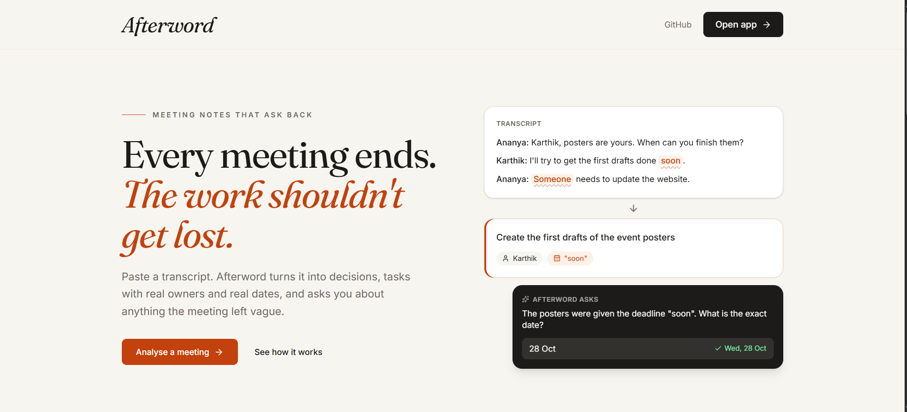
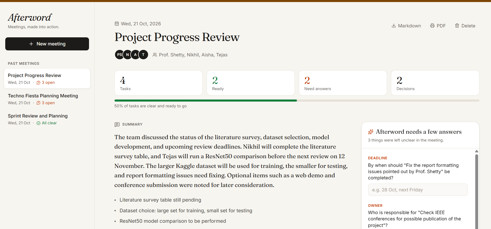
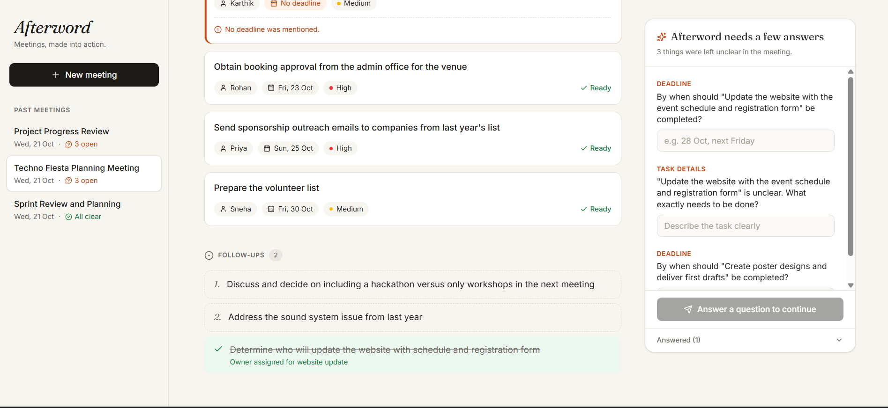

# Afterword

**Meetings, made into action.**

**Live demo:** https://afterword-nine.vercel.app

Afterword is an agentic AI assistant that reads a meeting transcript and turns it into a clear summary, the decisions that were made, tasks with owners and deadlines, and follow-up points. When something in the meeting was left vague, like a task with no owner or a deadline of "soon", Afterword notices it and asks you to clarify before marking the task as ready.

Built for the Agentic AI course project, problem statement **M1-P2: AI-Powered Meeting-to-Action Assistant**.



## Features

- Paste a transcript, upload a `.txt` file, or load a sample meeting
- Summary, key points, decisions, action items and follow-ups extracted in a few seconds
- Detects tasks with a missing or vague owner, deadline or description
- Asks clarification questions and keeps asking if the answer is still unclear
- Converts spoken deadlines like "by Friday" or "end of the month" into real dates
- Automatically marks follow-up points as resolved once the new information settles them
- Edit any task by hand
- Accounts with sign up and log in, so each user only sees their own meetings
- Meeting history saved between sessions
- Export as Markdown or a clean PDF report



## How the agent works

Afterword runs a five-step loop:

1. **Extract:** the LLM reads the transcript and returns structured JSON. The system prompt tells it never to invent names, dates or tasks.
2. **Validate:** Python rules check every task. Owners like "someone" or "the team", deadlines like "soon" or "sometime next week", and tasks like "look into the issue" are flagged.
3. **Clarify:** each problem becomes a question for the user.
4. **Update:** answers are applied and every task is checked again. A vague answer such as "whenever possible" gets rejected and the question is asked again.
5. **Reflect:** the LLM looks at what changed and decides which follow-up points are now settled. It only returns the index numbers of resolved items, so it cannot rewrite or invent follow-ups.

Meetings and the full question and answer history are stored per user, which acts as the agent's long-term memory.



## Security

- Passwords are never stored. Only a salted PBKDF2-SHA256 hash is saved.
- Logging in returns a signed JWT token, which is checked on every meeting request.
- A user can only read, edit or delete their own meetings.
- Wrong email and wrong password return the same message, so account emails cannot be discovered.

## Tech stack

| Part | Technology |
|---|---|
| Backend | Python, FastAPI, Pydantic |
| LLM | Groq (`openai/gpt-oss-120b`) through the OpenAI-compatible API. Gemini and OpenAI also work by changing `.env` |
| Auth | PBKDF2 password hashing, JWT tokens (PyJWT) |
| Database | MongoDB Atlas when deployed, local JSON files for development |
| Date parsing | dateparser plus custom rules |
| Frontend | React, Vite, Tailwind CSS, Lucide icons |
| Hosting | Vercel (frontend), Render (backend) |

## Project structure

```
afterword/
├── backend/
│   ├── app/
│   │   ├── main.py        API endpoints
│   │   ├── agent.py       the five-step agent loop
│   │   ├── auth.py        accounts, password hashing, JWT tokens
│   │   ├── db.py          MongoDB connection
│   │   ├── prompts.py     system prompts
│   │   ├── llm.py         LLM client with timeout and JSON retry
│   │   ├── schemas.py     data models
│   │   ├── storage.py     saves meetings per user
│   │   └── config.py      settings from .env
│   ├── samples/           example transcripts
│   ├── list_models.py     lists models available to your API key
│   └── requirements.txt
└── frontend/
    └── src/
        ├── App.jsx
        ├── api.js         API calls and login token
        ├── export.js      Markdown export
        └── components/    Landing, Auth, Sidebar, NewMeeting, MeetingView, TaskCard, ClarifyPanel
```

## Running it locally

### 1. Backend

```bash
cd backend
python -m venv venv
venv\Scripts\activate            # Windows
# source venv/bin/activate       # Mac / Linux
pip install -r requirements.txt
```

Generate a secret key for login tokens:

```bash
python -c "import secrets; print(secrets.token_hex(32))"
```

Create a file called `.env` inside `backend`:

```
LLM_API_KEY=your_groq_api_key
LLM_BASE_URL=https://api.groq.com/openai/v1
LLM_MODEL=openai/gpt-oss-120b
LLM_REASONING_EFFORT=low
LLM_TIMEOUT=60
JWT_SECRET=the_random_string_you_generated
JWT_EXPIRE_HOURS=72
FRONTEND_ORIGINS=http://localhost:5173
# Optional: use MongoDB instead of local JSON files
# MONGODB_URI=your_mongodb_atlas_connection_string
```

A free Groq key is available at https://console.groq.com. Then start the server:

```bash
uvicorn app.main:app --reload
```

### 2. Frontend

In a second terminal:

```bash
cd frontend
npm install
npm run dev
```

Open http://localhost:5173, click **Open app** and create an account.

## API

| Method | Endpoint | Purpose | Login |
|---|---|---|---|
| POST | `/api/auth/signup` | Create an account | No |
| POST | `/api/auth/login` | Log in, returns a token | No |
| GET | `/api/auth/me` | Current user | Yes |
| POST | `/api/analyze` | Analyse a transcript | Yes |
| GET | `/api/meetings` | List your meetings | Yes |
| GET | `/api/meetings/{id}` | Get one meeting | Yes |
| POST | `/api/meetings/{id}/clarify` | Answer the agent's questions | Yes |
| PATCH | `/api/meetings/{id}/tasks/{task_id}` | Edit a task | Yes |
| DELETE | `/api/meetings/{id}` | Delete a meeting | Yes |
| GET | `/api/samples` | Sample transcripts | No |

Interactive API docs are at http://localhost:8000/docs while the backend is running.

## Author

Minal Venkatesha Poppur, AIML, CMR Institute of Technology